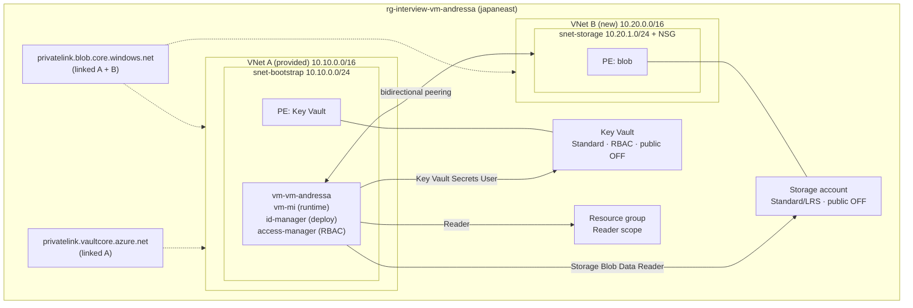

# Azure Infrastructure & Identity Challenge

Terraform deployment for secure Azure networking, least-privilege RBAC, and private PaaS connectivity. The bootstrap VM hosts all `terraform` and validation commands. Three managed identities enforce separation between provisioning, RBAC assignment, and runtime access.

## Architecture



**Data paths**

- **Blob:** `vm-mi` resolves the storage FQDN via private DNS → private IP in VNet B (over peering) → reads blob content with an Entra ID token.
- **Key Vault:** `vm-mi` resolves the vault FQDN via private DNS → private IP in `snet-bootstrap` (intra-subnet) → reads secret value with an Entra ID token.

Provided resources (resource group, VNet A, `snet-bootstrap`, bootstrap VM) are referenced as data sources and are not destroyed by `make destroy`.

## Prerequisites

| Tool | Purpose |
| :--- | :--- |
| Terraform ≥ 1.6 | Infrastructure deployment |
| Azure CLI | Validation scripts |
| `make`, `git`, `jq`, `curl` | Workflow automation and tests |

## Deploy

```bash
git clone <repository-url>

cp terraform/terraform.tfvars.example terraform/terraform.tfvars

make init
make validate
make plan
make apply
```

**Provider model**

| Provider | Identity | Scope |
| :--- | :--- | :--- |
| Default `azurerm` | `id-manager` | All infrastructure except RBAC assignments |
| `azurerm.rbac` (alias) | `access-manager` | `azurerm_role_assignment` resources only |
| `azapi` | `id-manager` | Key Vault dummy secret (ARM control-plane write) |

All three use `use_msi = true`; `azurerm.rbac` uses `access-manager`'s `client_id`, the other two use `id-manager`'s. Role definitions are read via the default provider; assignments are written via `azurerm.rbac`. The Key Vault secret is seeded via `azapi` instead of a role assignment — see [Design decisions](#design-decisions) below for why.

## Validate

Infrastructure validation uses bash scripts.

```bash
make test    # runs scripts/validate.sh
```

| Path | Purpose |
| :--- | :--- |
| `scripts/validate.sh` | Main validation — peering, DNS, public-access flags, RBAC, positive/negative data-plane checks |
| `scripts/helpers.sh` | Shared functions (`log`, `require_cmd`, etc.) |
| `tests/` | Reserved for future automated tests (e.g. Terratest); currently empty |

The validation script checks:

1. VNet peering `Connected` in both directions
2. Storage and Key Vault FQDNs resolve to private `10.x` addresses from the VM
3. Storage public network access and anonymous blob access are disabled
4. `vm-mi` holds exactly three role assignments (no extras, no forbidden roles)
5. `vm-mi` can read the dummy secret and blob (positive test)
6. `vm-mi` cannot write a secret or blob (negative test — least-privilege proof)

## Destroy

```bash
make destroy
```

`terraform destroy` removes candidate-managed resources only. The provided VM, VNet A, `snet-bootstrap`, resource group, and `nsg-vm-andressa` remain intact. Peering on VNet A and the Key Vault private endpoint in `snet-bootstrap` are removed.

## Design decisions

### Identity separation

| Identity | Role in design | Can provision | Can assign RBAC | Used at runtime |
| :--- | :--- | :---: | :---: | :---: |
| `id-manager` | Infrastructure automation | Yes | No | No |
| `access-manager` | RBAC automation | No | Yes | No |
| `vm-mi` | Workload runtime | No | No | Yes |

Routing `azurerm_role_assignment` through `id-manager` produces `403 Forbidden` by design.

### Key Vault private endpoint in `snet-bootstrap`

The Key Vault private endpoint is placed in the provided `snet-bootstrap` subnet (VNet A), not in VNet B.

- VNet A is the application-side network; the vault serves the bootstrap workload.
- The subnet hosts only the bootstrap VM and has sufficient address space.
- The vault path is intra-subnet and does not depend on peering.
- VNet B remains scoped to storage isolation; application secrets are not placed there.
- The provided NSG `nsg-vm-andressa` is **not modified** (recon: permissive rules).

A dedicated PE subnet in VNet A was omitted to minimize changes to the provided network.

### NSG on `snet-storage` (VNet B)

The only project-owned NSG applies to `snet-storage`. Inbound HTTPS (443) is allowed from `10.10.0.0/24` only. Explicit deny rules block other inbound and internet-bound outbound traffic. No `0.0.0.0/0` source is used.

### Provisioning seed vs runtime access

| Resource | `id-manager` seed (provisioning) | `vm-mi` runtime |
| :--- | :--- | :--- |
| Key Vault secret | None — `azapi_resource` ARM control-plane write | `Key Vault Secrets User` |
| Storage blob | Account key over private endpoint (default) | `Storage Blob Data Reader` (Entra ID) |

**Key Vault secret seeding.** The original plan was a `Key Vault Secrets Officer` grant for `id-manager` via `access-manager`, since an RBAC-authorization vault has no key-based shortcut for secret creation. Testing against the real environment showed this is impossible: `access-manager`'s own RBAC-assignment permission carries an ABAC condition restricting it to granting only `Reader`, `Key Vault Secrets User`, and `Storage Blob Data Reader`, the three `vm-mi` runtime roles, and nothing else, to any principal. Instead, the dummy secret is created with `azapi_resource`, which writes `Microsoft.KeyVault/vaults/secrets` directly as an ARM control-plane action (`Microsoft.KeyVault/vaults/secrets/write`), a normal `Contributor`-level action, unrelated to the vault's data-plane RBAC or network restrictions. `id-manager` needs no additional grant at all, and there's no RBAC propagation to wait for. This was verified working end-to-end, including with the vault's public network access disabled.

For storage, the default path uses `shared_access_key_enabled = true` to upload the dummy blob over the private endpoint without a `Storage Blob Data Contributor` grant, reducing RBAC propagation risk during `apply`. Public network access remains disabled; shared keys are not public access. `vm-mi` always reads blobs via Entra ID.

An optional hardening path disables shared keys and seeds the blob via Entra ID (`Storage Blob Data Contributor` + longer propagation wait). This applies to the storage seed only, the Key Vault seed has no RBAC propagation step to harden.

### Multi-environment scaling

This repository uses a single root module with local state for challenge scope. A production layout would use:

- Directory-per-environment (`envs/dev`, `envs/prod`) or Terraform workspaces
- Remote `azurerm` backend with state locking and versioning
- Shared modules (`network`, `identity`, `data-plane`)
- Separate subscriptions and deployment identities per environment

## RBAC matrix

| Resource | `vm-mi` | `id-manager` | `access-manager` |
| :--- | :--- | :--- | :--- |
| Resource group | Reader | Contributor *(pre-granted)* | Role Based Access Control Administrator *(pre-granted)* |
| Key Vault secret | Key Vault Secrets User *(single secret)* | None — seeded via `azapi_resource` | Creates assignments |
| Storage container | Storage Blob Data Reader | Account-key seed *(default)* | Creates assignments |
| Deploy infrastructure | — | Yes | No |
| Assign RBAC | — | No | Yes |
| Runtime access | Yes | No | No |

`access-manager`'s RBAC-assignment permission carries an ABAC condition restricting it to granting only the three `vm-mi` roles above, confirmed via `az role assignment list`, see [Provisioning seed vs runtime access](#provisioning-seed-vs-runtime-access).

### Why `vm-mi` needs three roles

| Role | Scope | Reason |
| :--- | :--- | :--- |
| Reader | Resource group | Required by the challenge; control-plane metadata only |
| Key Vault Secrets User | Single secret (`dummy-secret`) | Data-plane read of the secret **value** (`Key Vault Reader` is metadata-only) |
| Storage Blob Data Reader | Container | Data-plane read of blob **content** (control-plane `Reader` is insufficient) |

**Forbidden on `vm-mi`:** Contributor, Owner, User Access Administrator, Role Based Access Control Administrator, or any `*Contributor`/`*Owner` data role.

Both data-plane roles are scoped to the tightest resource available (single secret, single container) rather than the parent vault or account.

## Cost perspective (japaneast, approximate USD/month)

| Resource | SKU | Recurring cost | Notes |
| :--- | :--- | :--- | :--- |
| VNet B, subnets, NSG | — | $0 | — |
| VNet peering | — | ~$0 | Per-GB transfer only |
| Private DNS zones ×2 | — | ~$1.00 total | Plus negligible query charges |
| Private endpoint (blob) | Standard | **~$7.30** | ~$0.01/hr — primary recurring cost |
| Private endpoint (vault) | Standard | **~$7.30** | ~$0.01/hr — pairs with KV public access off |
| Storage account | Standard/LRS | ~$0.05 | Dummy payload is negligible |
| Key Vault | Standard | ~$0.01 | Per-operation pricing |
| Bootstrap VM | Provided | — | Out of scope |

**Estimated recurring total: ~$16/month**, dominated by the two private endpoints. Actual spend during grading is cents because the environment is ephemeral. Cost awareness means right-sized SKUs (Standard/LRS, Standard Key Vault, correct region) — not omitting justified private connectivity.

## Repository layout

```
├── terraform/          # Root module (network, dns, storage, keyvault, rbac)
├── scripts/            # Active validation (validate.sh, helpers.sh)
├── tests/              # Placeholder for future test suites (Terratest, etc.)
├── docs/               # Extended architecture and design notes
├── diagrams/           # Mermaid source
├── Makefile            # init, plan, apply, test, destroy
└── README.md
```

## Further reading

- [docs/architecture.md](docs/architecture.md)
- [docs/design-decisions.md](docs/design-decisions.md)
- [docs/rbac-matrix.md](docs/rbac-matrix.md)